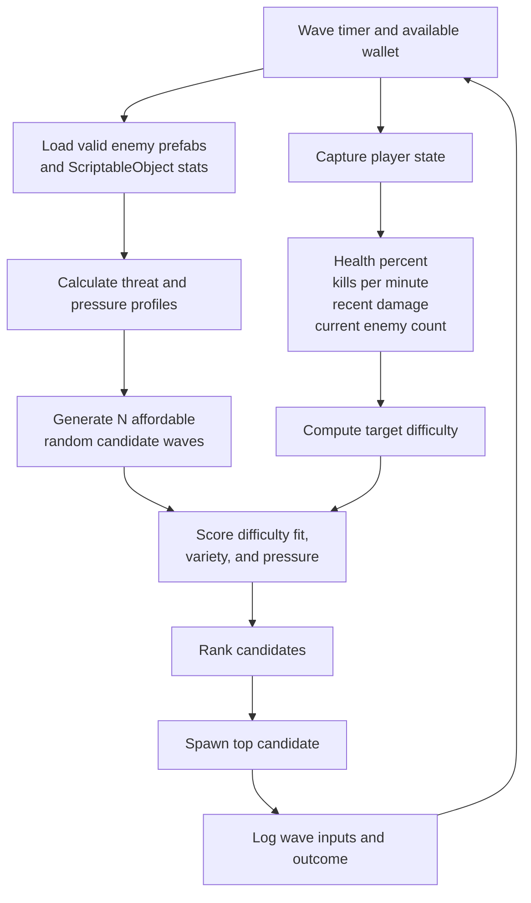

# Adaptive Wave Director

The adaptive-wave director is an in-progress gameplay system that chooses an enemy composition from a constrained budget instead of spawning a fixed sequence. It is designed to vary encounter pressure while reacting to the player's current performance.

## Candidate construction

Each enemy type has a positive spawn cost. For every candidate, the generator repeatedly selects a random enemy from the types affordable within the remaining budget. Once the remaining budget cannot buy another valid enemy, it calculates the candidate's aggregate metrics.

## Difficulty target

The director begins from a configured base target. It increases difficulty when player health is high or kills per minute are high, and lowers difficulty after substantial recent damage or when too many enemies are currently active. The result is clamped to a normalized range.

## Fitness function

Each wave is scored with a weighted combination of:

| Signal | Purpose |
| --- | --- |
| Difficulty fit | Prefer estimated difficulty close to the performance-derived target. |
| Variety | Reward compositions that use more than one viable enemy type. |
| Pressure | Account for aggregate enemy threat characteristics. |

The director selects the highest-scoring candidate, deducts its cost from the wave wallet, and begins telemetry for the spawned enemies. The source project includes Unity editor tests for the adaptive-wave behavior.
