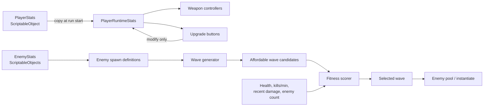
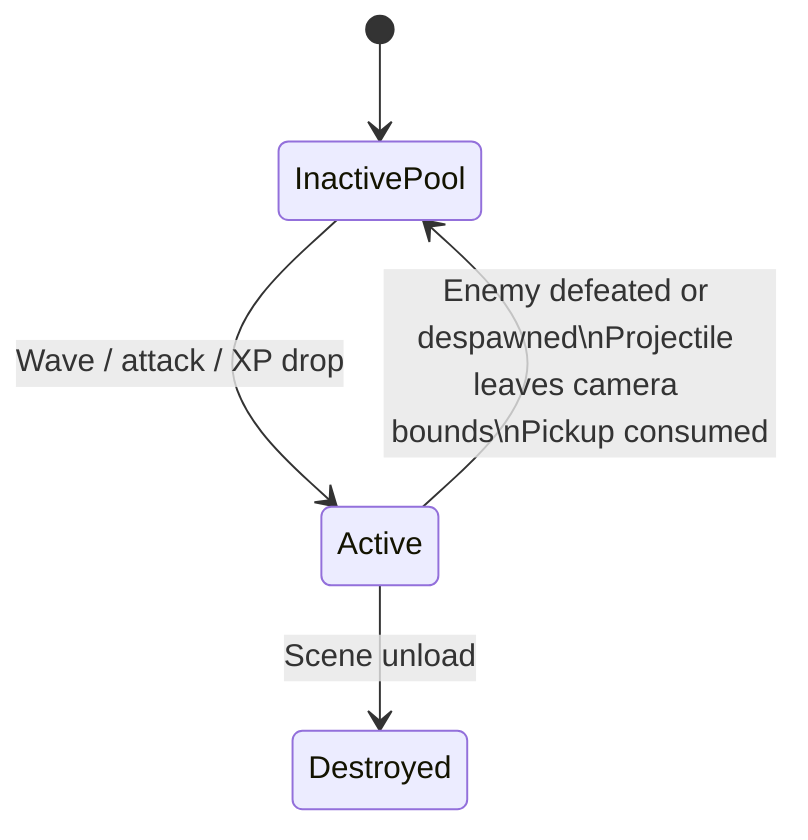

# Data Flow

## Why split base and runtime player data?

The base `PlayerStats` asset holds values shared by a character configuration: maximum health, damage, speed, cooldown, defense, pickup range, and attack type. A `PlayerRuntimeStats` instance begins as a copy and becomes the current run's mutable state.

That separation means a damage or cooldown upgrade has an immediate effect without permanently changing the editor-authored character asset. It also gives the game a clear reset point when a new run begins.

## Object lifecycle

Pools are used before creating a new object. Each system keeps an inactive collection; when work is needed, it reactivates a compatible object if available and otherwise instantiates a prefab.
