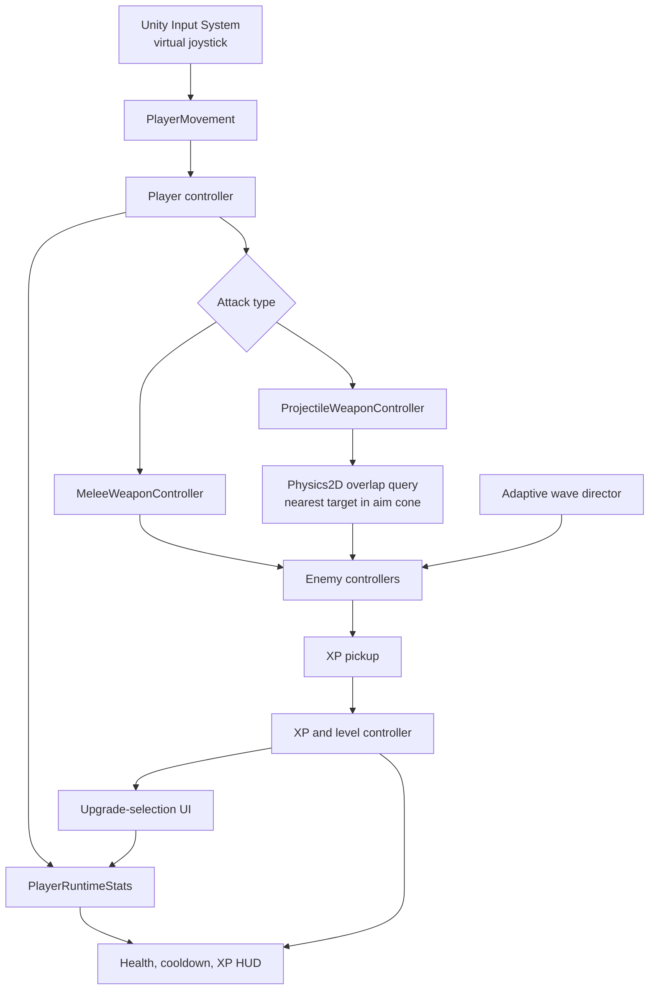

# Gameplay Architecture

## State boundaries

| Boundary | Representation | Reason |
| --- | --- | --- |
| Authored balance data | `PlayerStats` and enemy-stat ScriptableObjects | Designers can tune base values in the Unity Editor. |
| Run-specific player state | `PlayerRuntimeStats` | Upgrade choices do not mutate source assets. |
| Reusable scene objects | Prefabs plus inactive pools | Reuse reduces allocation during combat-heavy play. |
| Wave composition | Candidate objects generated from budget and enemy definitions | Wave composition can respond to player performance. |

## Combat

The player can use melee or projectile weapons through separate controllers that read the same runtime-stat data. Projectile attacks query nearby colliders on the enemy layer, reject targets outside the aim cone, and choose the nearest remaining target. If no enemy qualifies, the projectile fires along the current aim direction.

## Navigation and spawning

Enemies navigate the 2D arena around obstacles. Before a spawn is accepted, the spawner checks candidate positions against the playable floor, walls, configured obstacle layers, and a clearance radius. This avoids spawning enemies into blocked geometry or on top of nearby colliders.
